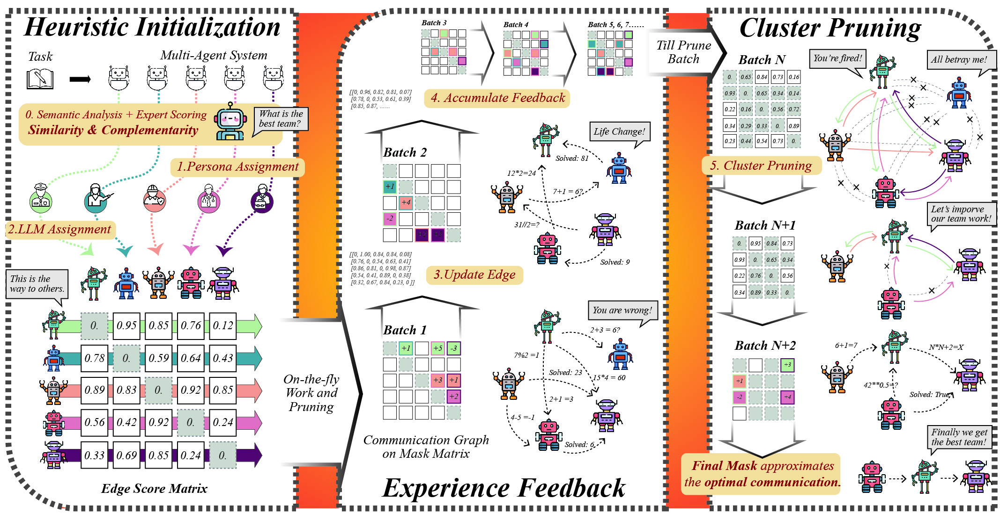

# SafeSieve

## Overview



SafeSieve is an economical, simple, and robust multi-agent communication framework, which can seamlessly integrate into mainstream multi-agent systems and prunes redundant or even malicious communication messages.

We provide the code of our paper. The algorithm implementation code is in `SafeSieve` folder, and the experimental code is in `experiments` folder.

## Quick Start

### Install packages

```bash
conda create -n safesieve python=3.10
conda activate safesieve
pip install -r requirements.txt
```

### API Configuration

```python
# Update in SafeSieve/llm/gpt_chat.py
API_URL = "" # the BASE_URL of OpenAI LLM backend
API_KEY = "" # for OpenAI LLM backend
```

### Download Datasets
Download MMLU, HumanEval and SVAMP datasets from MMLU, HumanEval and SVAMP. And put them in different folders.

### Run SafeSieve on MMLU by running the following scripts

```bash
python experiments/run_mmlu.py --use_llm_similarity --optimized_spatial 
```

The above code verifies the experimental results of the `mmlu` dataset.

If you want to try on heterogeneous setting, please add ```--heterogeneous_llms```.

```bash
python experiments/run_mmlu.py --use_llm_similarity --optimized_spatial --heterogeneous_llms
```

We also provide experimental code for other datasets and topologies.You can refer to `experiments/run_humaneval.py` and `experiments/run_svamp.py`.

## Acknowledgement

This code refers to [GPTSwarm](https://github.com/metauto-ai/GPTSwarm) and [AgentPrune](https://github.com/yanweiyue/AgentPrune.git).
